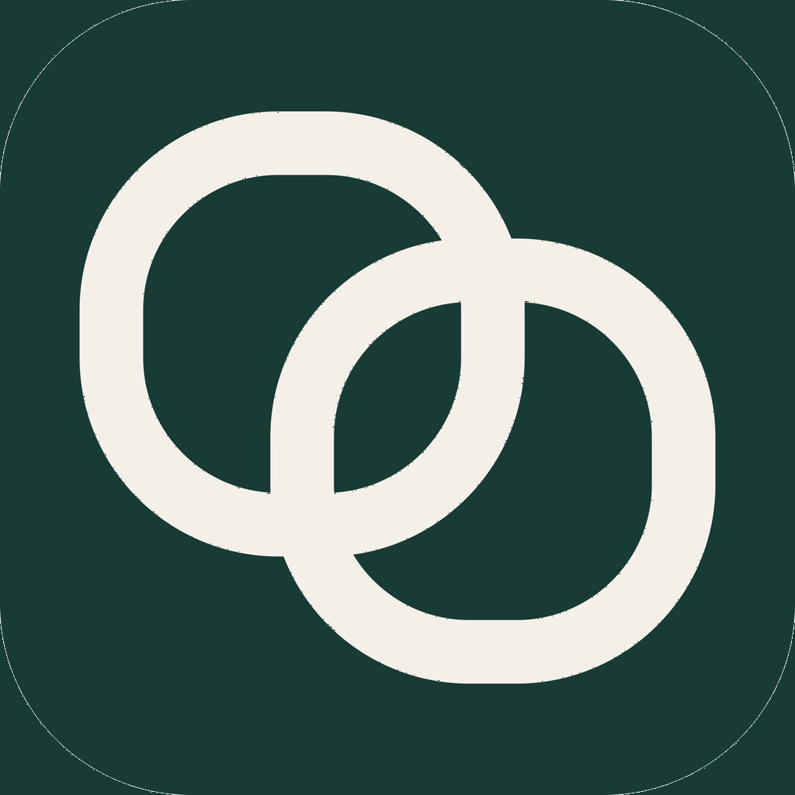
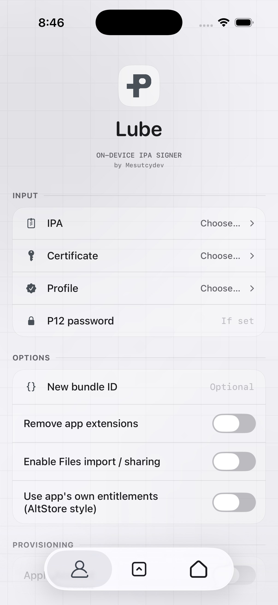
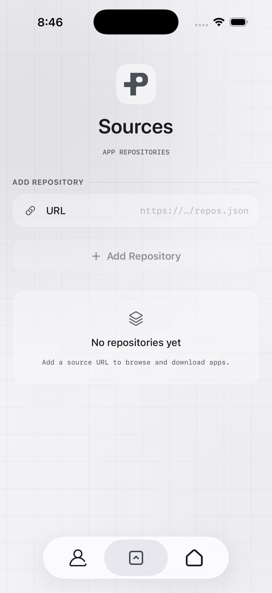
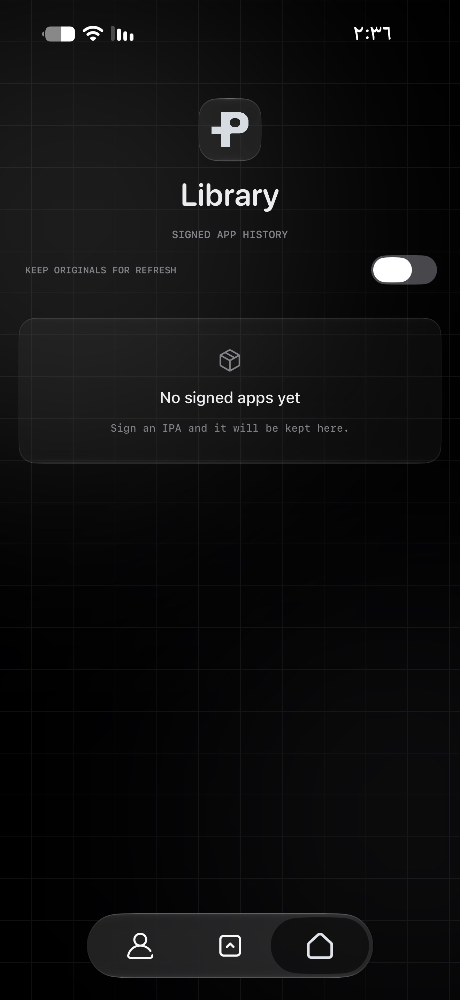

  

# Lube

موقّع IPA على الجهاز نفسه — بدون كمبيوتر. يوقّع التطبيقات ويجهّزها للتثبيت مباشرة على الآيفون أو الآيباد، بواجهة Liquid Glass.

نسخة Lube من تطوير **عبدالباسط خضير (Abdul Basit)**.

  
  
  

## المميزات

- توقيع فوري على الجهاز بشهادتك وبروفايلك، أو بحساب Apple مباشرة
- مكتبة تحفظ كل تطبيقاتك الموقّعة بأيقوناتها الحقيقية
- مصادر (Sources) لتحميل التطبيقات وتوقيعها من مكان واحد
- حقن dylib وفحص الحزمة قبل التوقيع
- iOS 16 فأحدث
